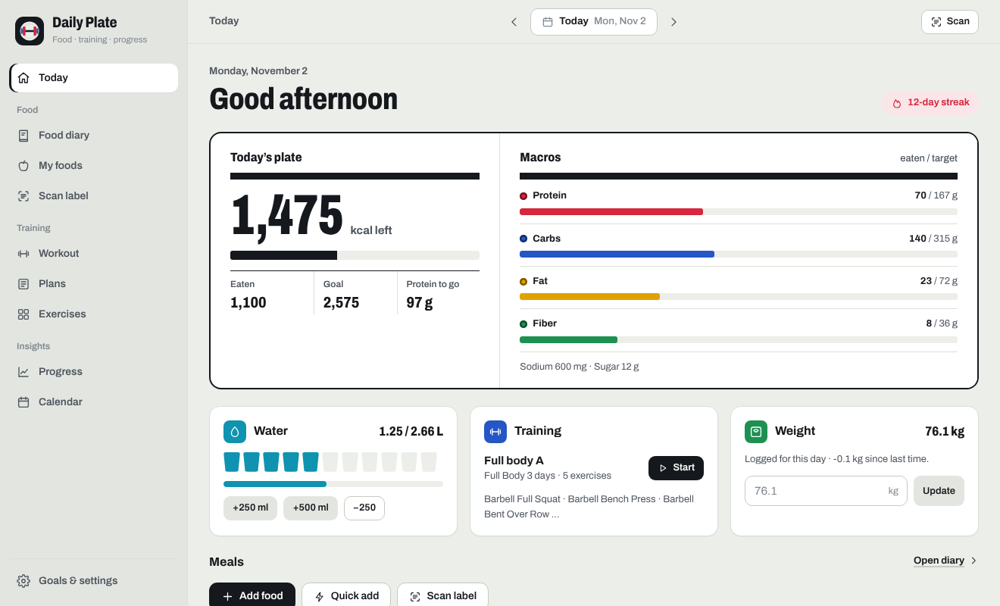

# Daily Plate

A gym training and nutrition tracker for your desktop. Log meals, scan nutrition labels, run your
workouts and watch your progress — all of it stays on your own device.



## What it does

- **Food diary** — log meals from a built-in food list (English and Chinese names), quick-add
  calories, copy yesterday's meals, and star the foods you eat most.
- **Label scanning** — photograph a nutrition table (Chinese 营养成分表 or English) and the
  calories and macros are read for you. You check them, then save the food.
- **Targets** — calorie, protein, carb, fat, fiber and water targets from your body, activity
  and goal (Mifflin–St Jeor), with a pace you choose.
- **Workouts** — start from your plan, log sets with last time's numbers beside them, rest timer,
  personal bests and a weight suggestion when you hit the top of your rep range.
- **Plans** — three starter plans; edit days and exercises and drag them into the order you like.
- **Exercise library** — 1,324 exercises with animations and step-by-step instructions in
  English and 中文.
- **Progress and calendar** — weight trend with a 7-day average, calories by day, training load,
  sets per muscle group, and a calendar of logged and missed days.
- **Backups** — export and import a backup file; the desktop app also keeps 14 days of backups.

## Run it

You need [Node.js](https://nodejs.org/) 20 or newer.

```bash
npm install
npm run media   # downloads the exercise photos and animations (see below)
npm run dev     # opens the app at http://localhost:5173
```

Desktop app (Windows, Electron):

```bash
npm run build         # builds the app into dist/
npm run desktop       # runs it
npm run package:win   # makes a ready-to-run folder in release/
```

Tests: `npm test`.

## Exercise media

The exercise photos and animations belong to [Gym visual](https://gymvisual.com/) and are not
included here. `npm run media` downloads them from
[hasaneyldrm/exercises-dataset](https://github.com/hasaneyldrm/exercises-dataset), which
redistributes them at 180×180 with Gym visual's permission. Their use is governed by Gym visual's
terms. Without them the app still works and shows placeholders instead.

## License

Copyright © 2026 EL BAZ ANAS.

Daily Plate is source-available under the
[PolyForm Noncommercial License 1.0.0](LICENSE). You may read, run and change it for personal,
study or other noncommercial purposes, as long as you keep the copyright notice. **You may not
sell it or use it commercially.** For any other use, ask for permission first.

Parts made by others keep their own licenses — see [NOTICE.md](NOTICE.md).
